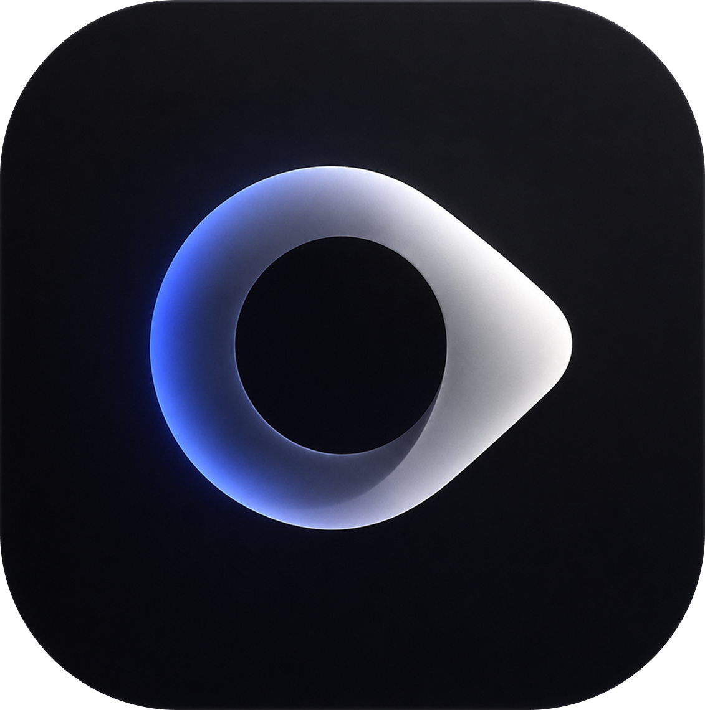

<p align="center">
  
</p>

<h1 align="center">Glance</h1>

<p align="center">
  Open-source AI desktop companion that sees your screen, points at things, and acts on them.
</p>

<p align="center">
  <a href="https://github.com/Anasabubakar/glance/releases/latest"><strong>Download v0.3.19</strong></a>&nbsp;&nbsp;|&nbsp;&nbsp;<a href="#quickstart">Quickstart</a>&nbsp;&nbsp;|&nbsp;&nbsp;<a href="#new-in-v0319">What's New</a>&nbsp;&nbsp;|&nbsp;&nbsp;<a href="#features">Features</a>&nbsp;&nbsp;|&nbsp;&nbsp;<a href="#providers">Providers</a>&nbsp;&nbsp;|&nbsp;&nbsp;<a href="#building-from-source">Build from source</a>
</p>

<br>

<p align="center">
  <a href="https://github.com/Anasabubakar/glance/releases/download/v0.3.19/Setup-Glance.exe">⬇ Windows (.exe)</a>&nbsp;&nbsp;&nbsp;
  <a href="https://github.com/Anasabubakar/glance/releases/download/v0.3.19/glance_0.3.19_amd64.deb">⬇ Linux (.deb)</a>&nbsp;&nbsp;&nbsp;
  <a href="https://github.com/Anasabubakar/glance/releases/download/v0.3.19/Glance-0.3.19-x86_64.AppImage">⬇ Linux (AppImage)</a>
</p>

<p align="center">
  <a href="https://github.com/Anasabubakar/glance/releases">All releases &amp; formats →</a>
</p>

---

Hold a hotkey, talk to your computer, let go. Glance captures your screen, listens to what you said, and responds with voice and a pointing cursor that flies to exactly what you asked about.

It works with **Claude**, **OpenAI**, **Gemini**, **GitHub Copilot**, or fully offline with **Ollama** — no API keys required for local mode.

---

## New in v0.3.19

- **Automations: fast, exact, no AI needed for almost everything.** Windows (minimize, tile, workspaces), apps and sites, system settings, the right keys for the app you're in, files, local answers (math, units, battery, clipboard), web helpers (search, directions, translate, calendar), and your own **routines, timers, reminders and schedules**. Chains like "minimize the terminal and then tile the browser left" run every part or none. Only requests that truly need understanding go to the AI.
- A new **Automations** page lists your routines and schedule and shows 100+ example phrases.
- Macros (record once, replay without AI) and a fix so the first click or stroke is never lost.

## New in v0.3.18

- **Typing fixed** (the first text typed used to be lost).
- **Drag and drop, draw and sketch** (shapes or freehand), **annotate** (circle, underline, arrow, label) and more click types (triple, middle, hover, ctrl/shift/alt-click).

## New in v0.3.17

- **Instant everyday commands with no AI:** minimize/close/switch windows, open apps, volume, keys, time, web search. The cursor still shows what it does.
- **Verified actions:** Glance checks that a click changed the screen, and stops honestly if it did not. **Esc stops it**, and it asks before sending, deleting, paying or posting.
- **Measured click accuracy** picks the best vision model; a one-click **checkup** on the Diagnostics page; **Lesson Recording** and **Workflow Capture** now work on GNOME Wayland; API keys are masked everywhere.

## New in v0.3.16

- **Opens any installed app by name** (Text Editor for "notepad", Files, Calculator, Brave...).
- **No more multi-minute waits:** Gemini gives up after 45 seconds and hands over to your next provider, and Glance says so out loud if every provider is busy.

## New in v0.3.15

- **Choose all your providers and put them in priority order:** #1 answers first, #2 takes over if it is busy or out of quota, and so on.
- **Several keys for every provider** (Gemini, Claude, OpenAI, Groq, OpenRouter), spread automatically.
- The Glance icon now shows in the dock on Wayland.

## New in v0.3.14

- **Several Gemini keys:** add as many as you like; Glance spreads requests across them and skips a key when it hits its limit.
- **Groq and OpenRouter,** with the free models listed on the Models page so you can pick one for text and one for vision.
- **Automatic fallback** to your other providers when the chosen one is busy or out of quota.

## New in v0.3.13

- **About 2-3 seconds per step with Gemini:** two models are asked at once and the first good answer wins.
- **You see the mouse do it:** Glance clicks the visible button, so the cursor flies there and clicks, instead of using a hidden shortcut.

## New in v0.3.12

- **Clicks and pointing land on the target with Gemini:** Glance now speaks Gemini's coordinate grid instead of treating it as pixels.
- **No more spoken code,** keyboard shortcuts are preferred, and Glance stops honestly when it is stuck.

## New in v0.3.11

- **Much faster with Gemini:** Glance remembers which models are fast and healthy and tries the best one first. Actions that took minutes now take seconds.
- **You can watch every step:** the cursor flies to the target and hovers before it clicks, and keys, typing and launches show a caption.

## New in v0.3.10

- **Screen capture, clicks and typing now work in the installed app.** The app's bundled libraries were breaking the system tool Glance uses to talk to GNOME; that is fixed.
- "Minimize", "switch to", "copy", "save" and similar requests go straight to the action path, and Glance no longer claims to see your screen when it can't.

## New in v0.3.9

- **Choose a text model and a vision model separately** on the Models page; choices apply immediately.
- A new default ElevenLabs voice.

## New in v0.3.8

- **Much faster answers** with Gemini, Ollama or a custom endpoint: requests are sorted locally instead of with an extra model call.
- Wake-word listening pauses while Glance works, and a clear "log out and back in once" message appears when the GNOME extension is out of date.

## New in v0.3.7

- **Glance Cloud is paused.** Glance runs on your own key (Gemini, Claude, OpenAI or any OpenAI-compatible endpoint) or on local Ollama.
- **Faster default models:** Claude Haiku 4.5, GPT-4o mini, the newest Gemini Flash, and Qwen2.5-VL 3B for local vision.

## New in v0.3.6

- **A completely redesigned app.** New design system, a grouped sidebar and **9 pages instead of 17**. Providers, keys and the custom endpoint are one **AI & Keys** page. The floating panel has clear listening / thinking / speaking states and a working **Hold to talk** button.
- **Settings now tell the truth:** toggles show real defaults, apply immediately, are remembered and match the tray menu. Secrets are always masked.
- **Glance can see and act on GNOME/Wayland.** Screen capture, clicks, typing and scrolling go through the GNOME extension (log out and back in once). It never clicks from a blank screenshot, and the free tier never clicks blindly.
- **Gemini works again.** Google retired the model names Glance used; Glance now asks Google which models your key can use and falls back when one is busy.
- **Voice:** the words after "Glance" are used as the command, and listening ends when you stop talking.

## New in v0.3.5

- **Glance Cloud no longer gets stuck.** The free-tier key is saved reliably and you get a clear message if the free tier is full or you're offline (it used to fail silently with `HTTP Error 429`).
- **Much faster free-tier replies:** about 6 s to the first word, then about 1 s (was about 40 s). The free tier is text-only and can't see your screen; use Ollama or your own vision model for that.
- Wake word ignores steady room noise and text whisper invents.

## New in v0.3.4

- **Hotkey works on GNOME/Wayland.** Apps can't see keys typed in other windows on Wayland, so the global hotkey never fired. The GNOME extension now grabs it in the compositor. Release Ctrl or Alt to send, or press the combo again to stop. **Log out and back in once** after updating.
- **Wake word is more forgiving.** Mishearings like "k-lax", "glans" and "clance" now match, unrelated words don't, and wake-word activity is logged to `~/.glance/logs/session.log`.
- The Esc "stop talking" key still doesn't work on Wayland.

## New in v0.3.3

- **Fix (Linux):** the .deb and AppImage exited at startup with `shell import failed`. The hotkey library's Linux backends were missing from the package; they are now bundled, and the release build smoke-tests the packaged app. If a v0.3.x Linux install would not launch, update to this version.

## New in v0.3.2

- **Fix:** the dashboard now opens. v0.3.0 and v0.3.1 hit a crash on startup (`name 'Qt' is not defined`) and fell back to the bare companion, which also hid the new Custom endpoint form. If you installed either, update.

## New in v0.3.1

### 🖱️ Always-on-top cursor on GNOME

The buddy cursor now stays **above every window and workspace**, follows your pointer smoothly, and no longer shows up in the taskbar or alt-tab. On GNOME, Glance installs a small shell extension on first launch; **log out and back in once** to turn it on. Other desktops use an improved overlay window (on X11 it is now pinned to every desktop and re-raised). Set `GLANCE_OVERLAY=qt` to force the old window.

## New in v0.3.0

### ☁️ Free Glance Cloud: no download, no key

Glance now works out of the box. With no API key set, it uses **Glance Cloud**, a free hosted text model, so you no longer need to install Ollama or pull a multi-GB model first. A personal rate-limited key is created automatically on first use.

- Text only: screenshots are not uploaded. For screen-aware features use local Ollama or your own vision model.
- Shared and rate-limited (about 6 requests/minute per user). Set `GLANCE_NO_CLOUD=1` to opt out.

### 🔌 Bring your own endpoint

Point Glance at **any OpenAI-compatible server** (OpenRouter, Groq, Together, LM Studio, vLLM, your own) from **API Keys → Custom endpoint**, or via `GLANCE_CUSTOM_BASE_URL`, `GLANCE_CUSTOM_API_KEY` and `GLANCE_CUSTOM_MODEL`.

---

## New in v0.2.0

### 🎛️ Desktop Launcher Dashboard

Glance now opens a **premium control dashboard** before launching the companion. Manage everything from one place:

- **Dashboard** — Launch Glance, view provider status, system health, recent activity
- **API Keys** — Add, test (HTTP validation), save, and remove keys for all providers
- **AI Providers** — Switch between Claude, OpenAI, Gemini, Copilot, and Ollama
- **Settings** — Configure hotkey, wake word, privacy guard, code mode, and more
- **Models** — Browse and select default models per provider
- **Ollama** — Check status, select vision/text models, pull new models with progress
- **Updates** — Check for new releases via GitHub API
- **Logs** — View, filter, search, export, and clear session logs
- **Diagnostics** — System info, provider health, cache analysis
- **Cache** — Manage model cache files
- **Memory** — Manage facts and skills Glance has learned
- **Security** — Credential inventory with masked values
- **And more** — Extensions, Workspace, Downloads, About, Advanced

> The launcher is the first thing you see when Glance starts — it's your control center.

### Other improvements

- Enhanced sidebar with Glance brand logo
- Smooth fade-in window transitions
- Keyboard navigation (Ctrl+[1-9] for pages)
- Premium card-based UI consistent with Glance's brand design system
- All 17 pages connect to real functionality — no mock data

---

## Quickstart

### Windows

1. Download [**Setup-Glance.exe**](https://github.com/Anasabubakar/glance/releases/download/v0.3.19/Setup-Glance.exe)
2. Run the installer
3. Launch Glance from the Start menu or desktop shortcut
4. The **Dashboard** opens — review your setup, then click **"Start Glance"**
5. Hold **Ctrl+Alt+M**, speak, release

> The binary is unsigned. Windows SmartScreen may warn on first run — click "More info", then "Run anyway".

### Linux

Choose your format:

**Debian / Ubuntu (recommended):**

```bash
wget https://github.com/Anasabubakar/glance/releases/download/v0.3.19/glance_0.3.19_amd64.deb
sudo apt install ./glance_0.3.19_amd64.deb
glance-companion
```

The .deb integrates with your system — adds a desktop entry, icons, and file associations. It also appears in GNOME Software / KDE Discover with screenshots.

**Any distro (AppImage):**

```bash
wget https://github.com/Anasabubakar/glance/releases/download/v0.3.19/Glance-0.3.19-x86_64.AppImage
chmod +x Glance-0.3.19-x86_64.AppImage
./Glance-0.3.19-x86_64.AppImage
```

No installation required. Just download, make executable, and run. Works on any Linux distribution.

### From source

```bash
git clone https://github.com/Anasabubakar/glance.git && cd glance
pip install -e ".[shell,claude,openai,gemini]"

# Linux only — system libraries for Qt and audio
sudo apt install libportaudio2 libgl1-mesa-dev libegl1-mesa-dev libxkbcommon-dev

glance run
```

---

## Features

**🎛️ Desktop Launcher Dashboard** — The new control center opens before Glance starts. Manage providers, keys, settings, models, logs, diagnostics, and more from a premium desktop interface.

**🎤 Voice interaction** — Hold Ctrl+Alt+M (configurable), speak naturally, release. Glance transcribes your speech locally with Whisper or via Deepgram, captures your screen, sends both to your chosen LLM, and speaks the response back.

**👆 Screen-aware pointing** — The cursor overlay flies to whatever you asked about. It snaps to real UI elements using the accessibility tree (UIA on Windows, AT-SPI2 on Linux), not just pixel coordinates.

**⚡ Direct action** — Glance can open applications, click buttons, type text, and run multi-step workflows on your behalf. It asks for confirmation before destructive actions like sending messages or deleting files.

**🔄 Provider switching** — Right-click the tray icon to switch between Claude, OpenAI, Gemini, Ollama, or GitHub Copilot. Each provider's available models are fetched and listed in a submenu. No restart needed.

**🔊 Wake word** — Say "Glance" hands-free to activate without the hotkey.

**📄 Document context** — Drag and drop a PDF, DOCX, or text file onto the panel. Glance reads it and uses it as context for your next question.

**🎬 Lesson recording** — Record your screen and Glance's responses as a video walkthrough.

**📋 Workflow capture** — Let Glance watch your clicks and keystrokes, then ask "what did I just do?" to get a summary or replay instructions.

**🔧 Setup wizard** — First launch walks you through provider keys, Ollama installation, and model selection. Detects what you already have installed and skips unnecessary steps.

**📁 File organizer** — A separate CLI tool that sorts messy folders using AI or heuristics, fully reversible with `glance undo`.

---

## Providers

| Provider | Key required | Notes |
|----------|-------------|-------|
| Ollama | No | Free, local, private. Glance auto-detects and installs it for you. |
| Claude | Yes | Highest quality vision and computer use. |
| OpenAI | Yes | GPT-4o and later models with vision. |
| Gemini | Yes | Google AI Studio. Free tier available. |
| GitHub Copilot | Copilot seat | Uses your existing subscription. Free models included. |
| Glance Cloud | No | Free hosted text model, the default when no key is set. No download. Text only (no screenshots), shared and rate-limited. |
| Custom (BYOK) | Yours | Any OpenAI-compatible endpoint: OpenRouter, Groq, Together, LM Studio, vLLM. Set it up under API Keys. |

One key is enough. Pick whichever provider you prefer, or use Ollama for a completely free and offline experience.

### Bring your own endpoint

Open **API Keys → Custom endpoint**, or set these in your `.env`:

```bash
GLANCE_CUSTOM_BASE_URL=https://openrouter.ai/api/v1
GLANCE_CUSTOM_API_KEY=sk-...
GLANCE_CUSTOM_MODEL=anthropic/claude-sonnet-4.5   # pick a vision model to keep screen features
```

Set `GLANCE_NO_CLOUD=1` to stop Glance falling back to the hosted free tier.

### Cursor overlay on GNOME

On GNOME, Glance installs a small shell extension so the buddy cursor stays above every window and workspace and follows your pointer smoothly. Log out and back in once after the first launch to enable it. Other desktops use a plain overlay window. Set `GLANCE_OVERLAY=qt` to force that.

### Ollama setup

```bash
curl -fsSL https://ollama.com/install.sh | sh
ollama pull llama3.2-vision
```

Set `GLANCE_ACTIVE_LLM=ollama` in your `.env`, or select Ollama from the Dashboard.

---

## Configuration

The Dashboard handles configuration on first launch. For manual setup:

| Context | Path |
|---------|------|
| Running from source | `glance/shell/.env` |
| Windows installer | `%LOCALAPPDATA%\Glance\.env` |
| Linux .deb / AppImage | `~/.local/share/Glance/.env` |

Key variables:

```
ANTHROPIC_API_KEY=sk-ant-...        # or OPENAI_API_KEY, or GOOGLE_API_KEY
DEEPGRAM_API_KEY=...                # optional: faster speech-to-text
GLANCE_ACTIVE_LLM=claude            # claude | openai | gemini | ollama | copilot
GLANCE_HOTKEY=ctrl+alt+m            # push-to-talk hotkey
```

---

## File organizer

Standalone CLI for sorting cluttered directories. Works independently from the voice companion.

```bash
glance organize ~/Desktop --dry-run    # preview moves (no API key needed in heuristic mode)
glance organize ~/Desktop              # execute
glance undo                            # reverse everything
```

---

## Platform support

| | Windows | Linux |
|---|---------|-------|
| Voice companion | Yes | Yes |
| Desktop Launcher Dashboard | Yes | Yes |
| Screen capture and vision | Yes | Yes |
| Cursor pointing overlay | Yes | Yes |
| UI element snapping | UIA | AT-SPI2 |
| Click, type, launch apps | Yes | Yes |
| System tray | Yes | Yes |
| Installer | .exe | .deb, AppImage |

---

## Download & install

All release assets are available on the [GitHub Releases page](https://github.com/Anasabubakar/glance/releases).

| Format | Platform | Description |
|--------|----------|-------------|
| `Setup-Glance.exe` | Windows | Inno Setup installer — desktop shortcut, start menu, uninstaller |
| `glance_VERSION_ARCH.deb` | Debian/Ubuntu | System package — integrates with GNOME/KDE software centers, adds desktop entry |
| `Glance-VERSION-x86_64.AppImage` | Any Linux | Portable — no install needed, works on any distro |

### Which Linux format should I choose?

- **.deb** — Best for Debian, Ubuntu, and derivatives. Integrates with your system: shows in the app menu, has screenshots in the software center, and supports auto-updates via apt.
- **AppImage** — Best for non-Debian distros (Fedora, Arch, etc.) or if you want portability. Download, `chmod +x`, run. No installation required.

### Windows notes

The installer provides a desktop shortcut and start menu entry. On first run, Windows SmartScreen may show a warning because the binary is not signed. Click **"More info" → "Run anyway"** to proceed.

---

## Building from source

### Linux

```bash
make install-deps       # pip install all extras + PyInstaller
make all-linux          # portable + AppImage + .deb in dist/
```

Individual targets: `make build-linux`, `make appimage`, `make deb`.

Requires Python 3.10+, pip, dpkg-deb (for .deb), FUSE and wget (for AppImage).

### Windows

```powershell
build.bat               # portable build in dist\Glance\
build.bat installer     # also builds Setup-Glance.exe (requires Inno Setup 6)
```

Requires Python 3.10+, pip. Inno Setup is optional and only needed for the .exe installer.

---

## Project structure

```
glance/
  shell/           Voice and screen companion (the main application)
    ui/
      launcher/    Desktop Launcher Dashboard (17 management pages)
  agent/           Computer-use actuation and permission model
  providers/       LLM provider abstraction (Claude, OpenAI, Gemini, Ollama, heuristic)
  platform/        OS-specific backends (Windows UIA, Linux AT-SPI2)
  cli.py           Entry point for organize, undo, run
packaging/
  linux/           Linux build scripts and specs
  generate_icons.py
  glance_app.py    PyInstaller entry point
frontend/          Landing page and documentation site (Next.js)
```

---

## Safety

The file organizer is move-only and fully reversible.

The voice companion acts directly on your machine. It stops before irreversible, high-stakes actions (sending messages, deleting files, making purchases) and asks for confirmation. Press **Esc** at any time to cancel. This is an early release operating on your real desktop — keep an eye on it.

---

## Roadmap

- Teachable skills — show Glance a routine once, recall it by name
- MCP server — expose screen vision and pointer as a tool for other agents
- Multi-monitor improvements
- Mobile companion app for remote status and control

---

## Credits and license

Built by [Anas Abubakar](https://github.com/Anasabubakar).

Glance builds on the work of several open-source projects:

- [Clicky](https://github.com/farzaa/clicky) by @farzaa — the original macOS screen companion concept
- [Clicky for Windows](https://github.com/Bitshank-2338/clicky-windows) by Bitshank-2338 — the PyQt6 Windows port that Glance's voice and pointing pipeline derives from
- [OpenClicky](https://github.com/jasonkneen/openclicky) by @jasonkneen — the actively maintained open-source Clicky fork

Released under the [MIT License](LICENSE).
